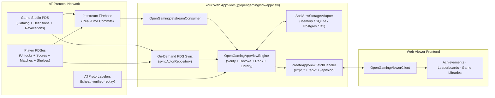

# Implementing an Open Gaming AppView & Web Viewer (`@opengaming/sdk/appview`)

Module export: `@opengaming/sdk/appview` (also re-exported from `@opengaming/sdk`)  
Reference implementation: [`apps/web/`](../apps/web/) (`opengaming.games`)

In the AT Protocol ecosystem, **Personal Data Servers (PDSes)** store canonical publisher definitions and signed player receipts, while **AppViews** index records across the network, verify cryptographic attestations, enforce revocations and moderation labels, and serve fast query APIs for web and native viewers.

The `@opengaming/sdk/appview` module provides both:
1. **Server-Side AppView Toolkit**: `OpenGamingAppViewEngine`, `AppViewStorageAdapter` (`MemoryAppViewStore`), `OpenGamingJetstreamConsumer`, `createAppViewFetchHandler`, and `fetchSafePdsBlob`.
2. **Frontend / Web Viewer SDK**: `OpenGamingViewerClient`, `verifyActorDirectFromPds` (zero-backend serverless PDS verification), and headless UI helpers (`maskAchievementForViewer`, `groupLibraryByShelf`, `buildLeaderboardColumns`).

---

## 1. AppView Architecture



---

## 2. Server Quickstart: Mounting an AppView in Minutes

`createAppViewFetchHandler` uses the standard Web Fetch `(request: Request) => Promise<Response>` signature, so it mounts into **Next.js App Router**, **Astro**, **Hono**, **Cloudflare Workers**, **Bun**, **Deno**, or **Node.js** without framework-specific wrappers.

### Example A: Next.js App Router (`app/api/opengaming/[...slug]/route.ts`)
```ts
import {
  OpenGamingAppViewEngine,
  OpenGamingJetstreamConsumer,
  createAppViewFetchHandler,
} from '@opengaming/sdk/appview';

// Singleton engine (swap `store` with Postgres/SQLite/Turso in production)
const engine = new OpenGamingAppViewEngine({
  blobProxyBasePath: '/api/opengaming/api/blob',
  trustedLabelerDids: ['did:plc:your-anticheat-labeler'],
});

// Optional: stream live firehose commits in persistent Node/Bun deployments
if (process.env.ENABLE_JETSTREAM !== 'false') {
  const jetstream = new OpenGamingJetstreamConsumer(engine);
  jetstream.start();
}

const handler = createAppViewFetchHandler(engine, {
  basePath: '/api/opengaming',
});

export const GET = handler;
export const POST = handler;
export const OPTIONS = handler;
```

### Example B: Hono / Cloudflare Workers / Bun
```ts
import { Hono } from 'hono';
import {
  OpenGamingAppViewEngine,
  createAppViewFetchHandler,
} from '@opengaming/sdk/appview';

const app = new Hono();
const engine = new OpenGamingAppViewEngine();
const appViewFetch = createAppViewFetchHandler(engine);

app.all('/xrpc/*', (c) => appViewFetch(c.req.raw));
app.all('/api/*', (c) => appViewFetch(c.req.raw));

export default app;
```

### Exposed Standard XRPC & Viewer Endpoints

| Endpoint | Method | Purpose |
| :--- | :--- | :--- |
| `/xrpc/games.opengaming.actor.getProfile` | `GET` | Standard XP-free Player Gamercard (`gamesPlayed`, `completedGames`, `totalUnlocks`, `tiers`, per-game completion & `bonusUnlockedCount`) |
| `/xrpc/games.opengaming.leaderboard.getScores` | `GET` | Ranked scores supporting `timeframe`, `scope=public\|social`, `viewer`, `player`, `includeObsolete`, `sortBy`, `dimensions`, `seed`, and `version` |
| `/api/library?actor=<did-or-handle>` | `GET` | Unified Player Game Library combining PDS shelf records + achievements + leaderboard PBs + PvP match stats |
| `/api/games` | `GET` | Indexed Games Catalog with achievement, leaderboard, and active player counts |
| `/api/game?uri=<at-uri>&viewer=<did>` | `GET` | Rich Game Hub with global unlock rarity `%`, spoiler-masked hidden achievements, challenges, leaderboards, and matches |
| `/api/matches` | `GET` | Verified PvP match history deduplicated across co-signing participants by `(game, matchId)` |
| `/api/blob?did=<did>&cid=<cid>` | `GET` | Safe `com.atproto.sync.getBlob` image proxy with MIME allowlisting and `Content-Security-Policy: default-src 'none'` |
| `/api/sync-repo` | `POST` | On-demand PDS backfill (`{ "actor": "alice.bsky.social" }`) |

---

## 3. Building Game Library Viewers

Web viewers like Backloggd/Steam-style shelves, launchers, and profile showcases want to display a player's **Game Library** even when games come from multiple ATmosphere sources.

`OpenGamingAppViewEngine.getActorLibrary` automatically unifies **four** signal sources per game without requiring a redundant schema migration:

1. **Game Catalog Metadata (`catalogCollections`)**:
   - Indexes `games.atmosphere.define` and `games.gamesgamesgamesgames.game` (plus any custom catalog NSIDs passed to `catalogCollections`) for game titles, descriptions, developer credits, URLs, and icons.
2. **Explicit Player Shelf Records (`libraryCollections`)**:
   - Indexes `games.atmosphere.library.item`, `games.atmosphere.library`, `games.gamesgamesgamesgames.library.item`, and `games.gamesgamesgamesgames.collection.item` (or custom NSIDs).
   - Normalizes shelf status (`playing`, `completed`, `backlog`, `wishlist`, `shelved`, `dropped`, `owned`), `favorite`, `rating`, `playtimeMs` / `playtimeMinutes`, and `note`.
3. **Activity-Derived Ownership (`achievements`, `leaderboards`, `matches`)**:
   - Even if a player has never manually added a game to a shelf collection, any game where they hold a verified `achievement.unlock`, `leaderboard.score`, or `match.result` automatically appears in their library (`sources` indicates `['shelf', 'achievements', 'leaderboards', 'matches']`), defaulting its status to `'completed'` (at `100%` core completion) or `'playing'`.

### Rendering Shelves in Your Web App
```ts
import {
  OpenGamingViewerClient,
  groupLibraryByShelf,
} from '@opengaming/sdk/appview';

const viewer = new OpenGamingViewerClient('https://opengaming.games');

const library = await viewer.getActorLibrary({
  actor: 'symmetricalboy.com',
  sortBy: 'recentActivity', // 'recentActivity' | 'completion' | 'title'
  locale: navigator.language,
});

const shelves = groupLibraryByShelf(library.items);
for (const { shelf, items } of shelves) {
  console.log(`Shelf "${shelf}" (${items.length} games)`);
  for (const game of items) {
    console.log(
      `  ${game.name}: ${game.achievements.completionPercent}% (${game.achievements.unlockedCount}/${game.achievements.totalAchievements})`,
      game.personalBests
    );
  }
}
```

---

## 4. Implementing Achievement & Gamercard Viewers

When building custom achievement UIs, follow the Open Gaming presentation rules (handled automatically by `engine.getGameDetail` and `maskAchievementForViewer`):

1. **No Global XP / Gamerscore**: Highlight per-game `100%` completion (`completed: true`), tier counts (`platinum`, `gold`, `silver`, `bronze`, `custom`), and global unlock rarity (`rarityPercent = unlockedPlayersCount / totalPlayers * 100`).
2. **Non-Penalizing Bonus Badges (`completionOptional: true`)**: Seasonal events, Game Jam badges, and DLC achievements set `completionOptional: true`. Display them in a "Bonus / Feats of Strength" group (`bonusUnlockedCount`) so players never lose a `100%` Perfect Game badge when new seasonal content drops.
3. **Two-Tier Spoiler Protection (`hidden` + `hiddenSpace`)**:
   - Always pass the logged-in user's DID/handle as `viewer` (`viewer.getGameDetail({ uri, viewer: currentUserDid })`).
   - If `hidden: true` and `viewerUnlocked === false`, `isMaskedSpoiler` is `true` and `title` / `description` / `iconUrl` are redacted. Once `viewerUnlocked === true`, the engine automatically unmasks the real artwork and localized text for that viewer!
4. **BCP-47 Localization & Active Timelocks**:
   - Pass `locale` (e.g. `'ja-JP'`, `'pt-BR'`) so `resolveTranslation` selects localized `title`, `description`, `requirement`, and `tooltip` strings.
   - Use `timelockActive` (`isWithinTimelock` over RFC 5545 `RRULE` schedules) to badge currently earnable seasonal/weekend events!

---

## 5. Implementing Leaderboard & PvP Match Viewers

`engine.getLeaderboardScores` and `buildLeaderboardColumns` handle all five leaderboard archetypes out of the box:

- **Dynamic Table Columns (`buildLeaderboardColumns`)**: Inspects `leaderboard.definition` and returns either a single `Score` column or ordered multi-component columns (`#points`, `#percentage`, `#time`, `#enum`, `#text`) honoring `componentOrder` and `defaultComponent`.
- **Sub-Board Dimensions (`?dimensions=mode=4k,scroll=upscroll`)**: Render `<select>` or pill filters from `definition.dimensions` (`getOrderedDimensionIds`) and pass the active selection to `viewer.getLeaderboardScores({ leaderboard, dimensions: { mode: '4k' } })`.
- **Speedrun PB History (`includeObsolete: true` + `player`)**:
  - Default competitive standings (`includeObsolete: false`) show one active rank per competitor (`!obsolete`).
  - Toggling `includeObsolete: true` (especially paired with `player: 'alice.bsky.social'`) returns the player's entire historical PB progression timeline!
- **Social Leaderboards (`scope: 'social'` + `viewer`)**: Filters rankings to `viewer` + accounts `viewer` follows on ATProto (`app.bsky.graph.getFollows`), while always returning `viewerEntry` so you can pin the current player's row at the top or bottom of the table.
- **Co-op Squad Deduplication (`runId`) & P2P Match Deduplication (`matchId`)**: Multiple teammates or opponents storing signed receipts for the same co-op run (`runId`) or 1v1 duel (`matchId`) in their respective PDSes automatically collapse into a single canonical entry.

---

## 6. Custom Database Persistence (`AppViewStorageAdapter`)

`MemoryAppViewStore` works out-of-the-box for prototypes, tests, and small edge deployments. For persistent production AppViews (see [`apps/web/src/db.ts`](../apps/web/src/db.ts) for a full SQLite schema reference), implement `AppViewStorageAdapter` against PostgreSQL, SQLite, Cloudflare D1, or Turso:

### Key Indexing & Reactive Re-Verification Rules
1. **Composite & Lookup Indexes**:
   - Index `achievement_unlocks` on `(player_did, verified, revoked)` and `(achievement_uri, verified, revoked)`.
   - Index `leaderboard_scores` on `(leaderboard_uri, verified, revoked)` and `(player_did)`.
   - Index `revocations` on `(publisher_did)` and `(attestation_cid)`.
   - Index `library_items` on `(player_did, status)` and `(game_uri)`.
2. **Reactive Re-Verification (Automatic in `OpenGamingAppViewEngine`)**:
   - Whenever a `games.opengaming.revocation` record is created, updated, or deleted (`unrevoke`), `OpenGamingAppViewEngine` automatically re-evaluates all stored unlocks, scores, and matches from that publisher.
   - Whenever an ATProto `com.atproto.label.defs#label` event (`!cheat`, `neg: true` appeal, or `verified-replay`) is passed to `engine.ingestLabel(label)`, affected records are immediately re-verified in place.
3. **Safe Blob Proxying (`fetchSafePdsBlob`)**:
   - Never hotlink arbitrary untrusted PDS blobs without MIME validation. `fetchSafePdsBlob` enforces `image/png | image/jpeg | image/webp | image/avif`, caps size at `<= 2.1 MB`, sets `Content-Security-Policy: default-src 'none'` + `X-Content-Type-Options: nosniff`, and applies `Cache-Control: public, max-age=86400, immutable`.

---

## 7. Zero-Backend Serverless Web Viewers (`verifyActorDirectFromPds`)

Building a static personal portfolio widget, itch.io companion page, or GitHub Pages trophy case **without running a backend server at all**?

Use `verifyActorDirectFromPds` in the browser — it resolves the player's `#atproto_pds`, discovers referenced game publisher DIDs, fetches their definitions and revocations, cryptographically verifies every DAG-CBOR CID and ECDSA signature in WebCrypto/JS, and returns the verified `profile` and `library`:

```ts
import { verifyActorDirectFromPds } from '@opengaming/sdk/appview';

const { profile, library } = await verifyActorDirectFromPds('alice.bsky.social', {
  locale: 'en-US',
});

console.log(`Verified ${profile.totalUnlocks} achievements across ${library.totalGames} games!`);
```
